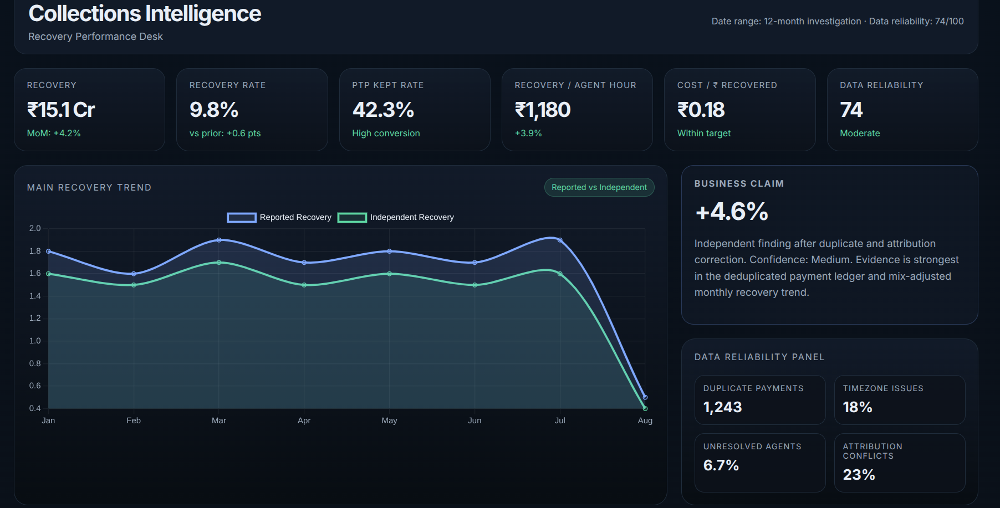
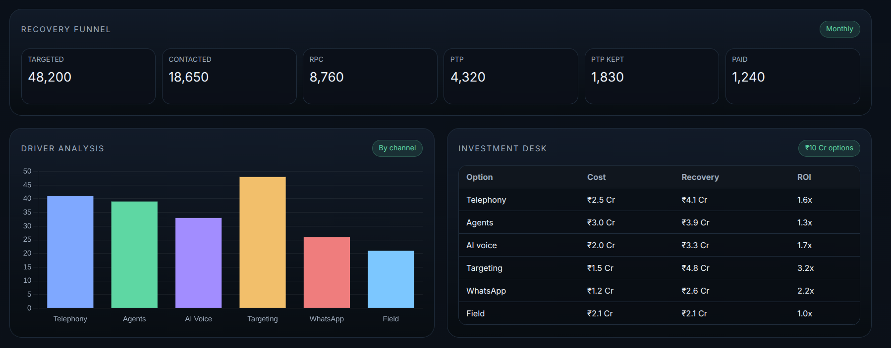

# CredResolve — Collections Intelligence Dashboard

### Recovery Performance, Data Quality & Investment Analytics

CredResolve is a collections intelligence and recovery analytics project designed to help business teams monitor recovery performance, identify data-quality issues, evaluate collection channels, and make data-informed investment decisions.

The project presents key operational and financial metrics through an interactive dashboard, bringing recovery trends, promise-to-pay performance, recovery funnel analysis, channel comparisons, and investment scenarios into a unified view.

## Dashboard Preview


### Recovery Funnel and Investment Analysis


*Collections Intelligence — Recovery Performance Desk*

## Key Features

### 1. Recovery Performance Monitoring
- Total recovery and month-over-month recovery movement.
- Recovery rate and promise-to-pay (PTP) kept rate.
- Recovery per agent-hour and cost per rupee recovered.
- Reported versus independently calculated recovery trends.

### 2. Data Reliability Analysis
- Monitoring of duplicate payment records.
- Identification of timezone inconsistencies.
- Tracking unresolved agent records.
- Detection of attribution conflicts that may affect reported performance.

### 3. Recovery Funnel
Track the collections journey through six stages:

**Targeted → Contacted → Right Party Contact (RPC) → Promise to Pay (PTP) → PTP Kept → Paid**

This funnel helps identify where accounts drop off and where operational improvements may be needed.

### 4. Channel Performance Analysis
Compare collection channels such as:
- Telephony
- Agents
- AI Voice
- Targeting
- WhatsApp
- Field collections

The dashboard provides a comparative view of channel-level performance to support further investigation and resource allocation.

### 5. Investment Decision Support
The Investment Desk compares potential allocation options using:
- Investment cost
- Expected recovery
- Return on investment (ROI)

This helps decision-makers compare investment scenarios and identify options for further validation.

### 6. Business Claim Validation
Compare reported recovery performance with independently calculated results after considering potential duplicate payments and attribution issues.

The objective is to distinguish reported business improvements from improvements supported by a consistent metric definition and reliable data.

## Technology Stack

The project is organized around a web-based analytics dashboard.

| Technology | Purpose |
|---|---|
| HTML5 | Dashboard structure |
| CSS3 | Layout, styling, and responsive presentation |
| JavaScript | Dashboard interactions and client-side logic |
| Data visualization | Recovery trends and channel comparisons |
| Data analytics | KPI monitoring, funnel analysis, and performance comparison |

*The technology list should be updated if the implementation uses a specific charting library, analytics framework, or backend.*

## Project Structure

The confirmed dashboard entry point is located at:

```text
CredResolveeeee/
└── collections-intelligence/
    └── dashboard/
        └── index.html
```

Other files and directories may provide styling, scripts, datasets, or supporting analysis.

## Getting Started

### Prerequisites

- Git
- Python 3
- A modern web browser, such as Google Chrome or Firefox

### 1. Clone the repository

```bash
git clone https://github.com/guptasakshi06/CredResolveeeee.git
cd CredResolveeeee
```

### 2. Navigate to the dashboard

```bash
cd collections-intelligence/dashboard
```

### 3. Start a local HTTP server

```bash
python3 -m http.server 8000
```

### 4. Open the dashboard

Visit:

http://localhost:8000

To stop the server, press `Ctrl + C` in the terminal.

**Note:** If the dashboard relies on additional assets, external libraries, or API services, those dependencies must also be available for all features to work correctly.

## Key Business Metrics

The dashboard screenshot includes the following metrics:

| Metric | Purpose |
|---|---|
| Recovery | Measures the value recovered |
| Recovery Rate | Tracks recovery relative to the relevant eligible base |
| PTP Kept Rate | Measures fulfilled payment promises |
| Recovery per Agent-Hour | Evaluates operational productivity |
| Cost per ₹ Recovered | Tracks collection efficiency |
| Data Reliability | Summarizes the quality of underlying data |

Exact metric formulas and denominators should be documented alongside the underlying data and analytical logic.

## Analytical Approach

A reliable collections analytics workflow should:

1. Validate source data and identify missing or inconsistent records.
2. Detect duplicate payments and other potential sources of metric inflation.
3. Define consistent recovery metrics and eligible populations.
4. Compare reported performance with independently calculated results.
5. Analyze conversion across recovery funnel stages.
6. Compare collection channels using clearly defined performance measures.
7. Evaluate investment scenarios while distinguishing assumptions from observed results.

## Business Value

CredResolve aims to make collections performance easier to understand and investigate by bringing operational KPIs, data-quality indicators, channel comparisons, and investment scenarios together in one dashboard.

Potential applications include:
- Monitoring collection operations.
- Identifying data-quality risks.
- Investigating recovery performance changes.
- Comparing collection strategies.
- Supporting evidence-based resource allocation.

## Future Improvements

- Add filters for reporting period, collection channel, and customer segment.
- Connect the dashboard to a validated analytics dataset or backend API.
- Document KPI formulas and data lineage.
- Add automated data-quality checks and anomaly alerts.
- Introduce controlled experiments to estimate the incremental impact of collection strategies.
- Add exportable reports for business reviews.

## Author

**Sakshi Gupta**
---

